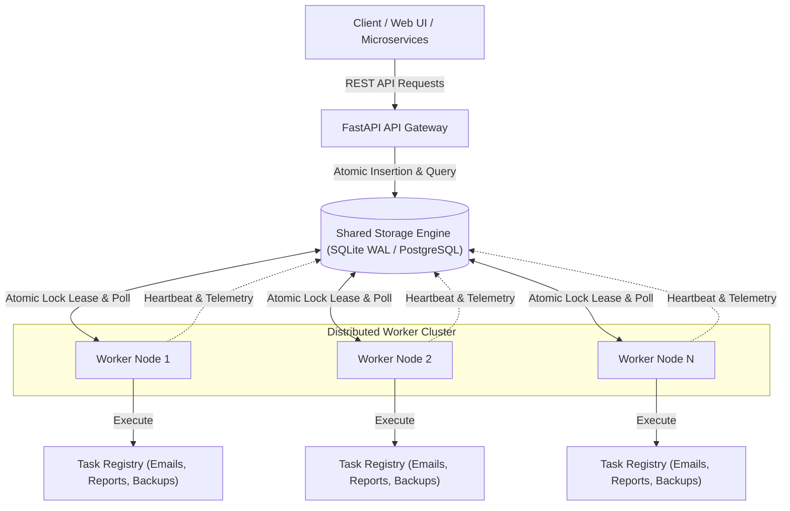
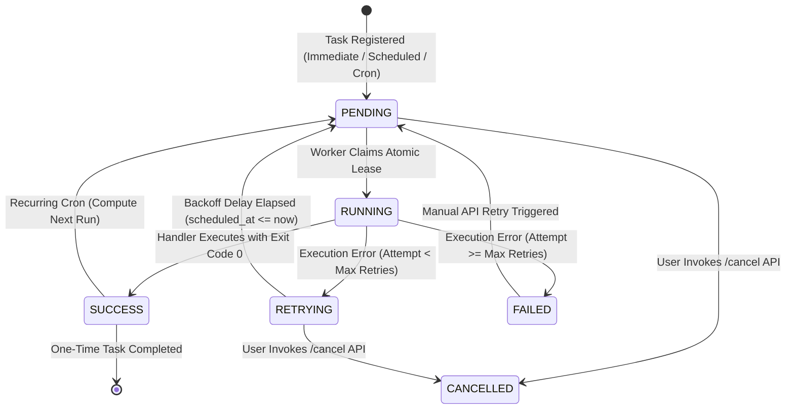

# Enterprise Technical Specification & Production Architecture Document
## Project: Distributed Job & Task Scheduling Engine
**Target Roles**: Backend Engineer, Distributed Systems Engineer, Platform/Infrastructure Engineer  
**System Classification**: High-Reliability Asynchronous Task Orchestration & Distributed Execution Engine  
**Version**: 1.0.0 Production Spec  

---

## 1. Executive Summary & Business Context

### 1.1 The Business Problem
Modern web and cloud architectures face severe throughput bottlenecks when synchronous HTTP request-response cycles attempt to execute long-running operations—such as:
- Asynchronous batch email/SMS dispatches
- Heavy financial ledger & end-of-month billing report aggregations
- Large video transcoding and image processing pipelines
- Periodic database maintenance, snapshot backups, and index rebuilding

Executing these operations synchronously degrades API latency, spikes connection pools, exhausts client request timeouts, and leads to cascaded server failure under peak traffic.

### 1.2 The Solution
This project implements an **Enterprise Distributed Job & Task Scheduling Engine**. It decouples task submission from task execution through:
1. **At-Least-Once Execution Guarantees**: Tasks never get lost, even during sudden worker termination.
2. **Distributed Mutual Exclusion**: Multiple worker nodes run concurrently across clusters without race conditions or duplicate task executions.
3. **Automated Worker Crash Recovery**: Lock lease TTLs ensure abandoned tasks from crashed nodes are auto-healed and re-executed.
4. **Exponential Backoff Retries & Dead-Letter Queue (DLQ)**: Resilient self-healing for transient network glitches with dead-letter isolation for permanent failures.
5. **Real-Time Observability**: Sub-millisecond latency audit logs, cluster heartbeat telemetry, and an interactive operational dashboard.

---

## 2. System Architecture (High-Level Design)

### 2.1 Component Flow



### 2.2 Task Lifecycle & State Transitions



---

## 3. Low-Level Engineering & Core Algorithms (LLD)

### 3.1 Distributed Locking & Mutual Exclusion
To guarantee that no two worker nodes ever execute the same task simultaneously, the engine utilizes **atomic transactional leases** with Time-To-Live (TTL).

#### Mechanism
1. Worker queries for candidate tasks where `status IN ('PENDING', 'RETRYING')` AND `scheduled_at <= CURRENT_TIMESTAMP`.
2. Inside an immediate transaction (`BEGIN IMMEDIATE`), the state transition and lease assignment occur atomically:
   ```sql
   UPDATE tasks
   SET status = 'RUNNING',
       locked_by = :worker_id,
       lock_expires_at = :now + :ttl_seconds,
       updated_at = :now
   WHERE id = :candidate_id
     AND status IN ('PENDING', 'RETRYING');
   ```
3. SQLite's write-ahead logging (WAL) mode guarantees serializable isolation for writes while allowing concurrent non-blocking reads. If another worker attempts to claim the same row concurrently, SQLite's transactional lock prevents double-claiming, and the second worker receives 0 updated rows and moves to the next candidate.

### 3.2 Worker Node Crash Recovery (Zombie Leases)
A major point of failure in distributed architectures occurs when a worker node crashes (OOM kill, machine reboot, network partition, segfault) while holding a task in `RUNNING` status.

#### Algorithm
1. Every claimed task has an assigned lease expiry: `lock_expires_at = now + 30s`.
2. While healthy, the executing worker's heartbeat daemon periodically extends the lease:
   $$\text{lock\_expires\_at} \leftarrow \text{now} + 30\text{s}$$
3. If the worker process dies abruptly, the lease stops extending.
4. When any surviving worker polls for tasks, it first executes the **Zombie Detection Query**:
   ```sql
   SELECT id, name, retry_count, locked_by
   FROM tasks
   WHERE status = 'RUNNING'
     AND lock_expires_at < :now
   ORDER BY scheduled_at ASC
   LIMIT 1;
   ```
5. If found, the orphaned task is immediately reclaimed by the surviving worker, logged as a recovered zombie task, and resumed safely.

### 3.3 Concurrency & Thread Pool Management
- Each worker node initializes a dedicated `ThreadPoolExecutor` sized according to hardware capacity (default: 4 concurrent workers).
- Worker threads pull tasks from the scheduler daemon without blocking the main event loop or HTTP endpoints.
- Active task counts are reported back to the `worker_heartbeats` table, giving full visibility into cluster-wide worker utilization.

### 3.4 Exponential Backoff & Jitter Algorithm
When tasks interact with external microservices or third-party APIs (e.g. Stripe, SendGrid, S3), transient failures (HTTP 503, connection timeouts) are common. Immediate retries cause catastrophic "thundering herd" spikes.

The engine calculates retry delay using exponential backoff with uniform random jitter:

$$\text{delay} = \text{base\_delay} \times 2^{(\text{attempt} - 1)} + \text{jitter}$$

Where:
- $\text{base\_delay} = 2.0\text{ seconds}$ (configurable per task)
- $\text{attempt} \in [1, \text{max\_retries}]$
- $\text{jitter} \sim \mathcal{U}(0.1, 0.5)\text{ seconds}$

#### Progression Example:
- **Attempt 1 Failure**: Delay $\approx 2.0 \times 2^0 + 0.3 = 2.3\text{s}$
- **Attempt 2 Failure**: Delay $\approx 2.0 \times 2^1 + 0.2 = 4.2\text{s}$
- **Attempt 3 Failure**: Delay $\approx 2.0 \times 2^2 + 0.4 = 8.4\text{s}$
- **Attempt 4 Failure**: Retry threshold exceeded $\rightarrow$ task transitions to **Dead-Letter Queue (`FAILED`)**.

### 3.5 Cron & Interval Schedule Computation
The scheduler implements a native cron parsing engine supporting:
- Standard 5-field syntax: `minute hour day_of_month month day_of_week`
- Step values (`*/5`), value lists (`1,15,30`), and value ranges (`1-5`)
- Common macros: `@hourly`, `@daily`, `@weekly`, `@monthly`
- High-resolution interval macros: `@every 15s`, `@every 30s`, `@every 2m`

When a recurring cron task finishes execution (whether success or failure), the engine computes the next run timestamp via `get_next_run(cron_expression)` and resets the task to `PENDING` state with `retry_count = 0`.

---

## 4. Database Architecture & Data Models

### 4.1 Schema Definition (DDL)

```sql
-- Tasks Queue & Master State Table
CREATE TABLE tasks (
    id TEXT PRIMARY KEY,
    name TEXT NOT NULL,
    payload TEXT NOT NULL,
    status TEXT NOT NULL,               -- PENDING, RUNNING, SUCCESS, RETRYING, FAILED, CANCELLED
    schedule_type TEXT NOT NULL,        -- IMMEDIATE, TIMESTAMP, CRON
    cron_expression TEXT,
    scheduled_at TEXT NOT NULL,
    created_at TEXT NOT NULL,
    updated_at TEXT NOT NULL,
    max_retries INTEGER NOT NULL DEFAULT 3,
    retry_count INTEGER NOT NULL DEFAULT 0,
    retry_delay_seconds REAL NOT NULL DEFAULT 2.0,
    timeout_seconds REAL NOT NULL DEFAULT 60.0,
    locked_by TEXT,                     -- Worker ID holding execution lock
    lock_expires_at TEXT,               -- Lock lease expiration timestamp (TTL)
    last_run_at TEXT,
    completed_at TEXT,
    result TEXT,
    error_message TEXT
);

-- Performance Index for Queue Polling
CREATE INDEX idx_tasks_poll ON tasks(status, scheduled_at);

-- Performance Index for Zombie Detection
CREATE INDEX idx_tasks_lock ON tasks(locked_by, lock_expires_at);

-- Comprehensive Execution History & Audit Logs
CREATE TABLE task_logs (
    id INTEGER PRIMARY KEY AUTOINCREMENT,
    task_id TEXT NOT NULL,
    attempt INTEGER NOT NULL,
    worker_id TEXT NOT NULL,
    status TEXT NOT NULL,
    started_at TEXT NOT NULL,
    finished_at TEXT,
    duration_ms REAL,
    result TEXT,
    error TEXT,
    FOREIGN KEY (task_id) REFERENCES tasks(id) ON DELETE CASCADE
);

CREATE INDEX idx_task_logs_task_id ON task_logs(task_id, attempt);

-- Cluster Telemetry & Heartbeat Monitoring
CREATE TABLE worker_heartbeats (
    worker_id TEXT PRIMARY KEY,
    hostname TEXT NOT NULL,
    pid INTEGER NOT NULL,
    concurrency INTEGER NOT NULL,
    active_tasks INTEGER NOT NULL DEFAULT 0,
    last_heartbeat TEXT NOT NULL
);

-- Named Distributed Locks Table
CREATE TABLE distributed_locks (
    lock_key TEXT PRIMARY KEY,
    owner TEXT NOT NULL,
    acquired_at TEXT NOT NULL,
    expires_at TEXT NOT NULL
);
```

---

## 5. Complete REST API Specification

### 5.1 Endpoints Summary

| Method | Endpoint | Description |
| :--- | :--- | :--- |
| `GET` | `/` | Responsive Real-Time Monitoring Web Dashboard |
| `GET` | `/docs` | OpenAPI / Swagger Interactive Documentation |
| `GET` | `/api/health` | Cluster & Database Health Check |
| `GET` | `/api/metrics` | Real-time queue counters, active workers & telemetry |
| `POST` | `/api/tasks` | Register a new task (Immediate, Timestamp, or Cron) |
| `GET` | `/api/tasks` | List tasks with filtering by status and name |
| `GET` | `/api/tasks/{task_id}` | Retrieve full task details and execution audit trail |
| `POST` | `/api/tasks/{task_id}/trigger` | Force immediate execution of a scheduled task |
| `POST` | `/api/tasks/{task_id}/retry` | Re-queue a failed (dead-lettered) task |
| `POST` | `/api/tasks/{task_id}/cancel` | Cancel a pending or retrying task |
| `DELETE`| `/api/tasks/{task_id}` | Remove task and historical audit logs |
| `GET` | `/api/workers` | List active worker nodes and heartbeat telemetry |
| `GET` | `/api/task-types` | List registered task handlers |

---

## 6. Resilience, Fault Tolerance & Failure Modes

| Failure Scenario | Engine Protection Mechanism | Result |
| :--- | :--- | :--- |
| **Worker Crashes Mid-Task** | Time-To-Live (TTL) lease expiry + Zombie Recovery daemon | Another worker claims the expired lease and retries task automatically. |
| **Network Spike / Timeout** | Exponential Backoff with Random Jitter | Retries over expanding intervals without overloading downstream services. |
| **Multiple Worker Race Condition** | `BEGIN IMMEDIATE` write transactions with WAL mode | Exactly one worker succeeds in obtaining the lock; zero duplicate runs. |
| **Dead-Letter Trapping** | `FAILED` status threshold with error traces preserved | Failed tasks do not block the active queue; developers can inspect and retry. |
| **Long-Running Task Expiry** | Background lease extension heartbeat daemon | Active running tasks never expire as long as the worker remains healthy. |
| **Application Shutdown** | Graceful drain handler (`stop(wait=True)`) | Active tasks complete cleanly before worker processes terminate. |

---

## 7. Testing Strategy & Test Coverage

The documented test suite is `tests/test_scheduler.py`. The current workspace contains only this documentation file; the test module and application source are not present, so the test count and behavior below have not been verified here. Once the source files are available from the project root, run:

```bash
python -m unittest tests/test_scheduler.py
```

### Verification Matrix
- **`test_cron_parser_validity`**: Verifies valid/invalid 5-field syntax and interval strings.
- **`test_cron_next_run`**: Verifies exact next-run calculation for future timestamps.
- **`test_distributed_lock_mutual_exclusion`**: Verifies that when Worker A holds a lock, Worker B is rejected.
- **`test_immediate_task_execution`**: Verifies end-to-end task pickup, execution, logging, and status transition to `SUCCESS`.
- **`test_fault_tolerance_exponential_backoff`**: Verifies flaky simulated service fails twice, computes backoff, and succeeds on attempt 3.
- **`test_dead_letter_queue_on_max_retries`**: Verifies terminal failure transitions to `FAILED` status with stack trace preserved.
- **`test_worker_crash_zombie_recovery`**: Injects an expired lock simulating a dead worker; verifies surviving worker reclaims it.
- **`test_concurrent_task_processing`**: Verifies multi-threaded concurrent execution across worker slots.

---

## 8. Deployment, Containerization & Infrastructure

### 8.1 Docker & Docker Compose
The intended multi-node deployment uses `docker-compose.yml`:

```yaml
version: '3.8'

services:
  scheduler-api:
    build: .
    ports:
      - "8000:8000"
    environment:
      - API_HOST=0.0.0.0
      - API_PORT=8000
      - WORKER_CONCURRENCY=4
      - DATABASE_PATH=/data/scheduler.db
      - START_EMBEDDED_WORKER=true
    volumes:
      - scheduler_data:/data

  scheduler-worker-2:
    build: .
    command: ["python", "run.py", "--worker-only", "--concurrency", "4"]
    environment:
      - DATABASE_PATH=/data/scheduler.db
      - WORKER_CONCURRENCY=4
    volumes:
      - scheduler_data:/data
    depends_on:
      - scheduler-api

volumes:
  scheduler_data:
```

### 8.2 Production Run Command
```bash
docker compose up --build
```

This command requires the Compose file and application build files to be present in the project root. They are not included in the current workspace, so the deployment cannot be started from this folder as it stands. Likewise, the worker command shown above runs `run.py` inside the container; it does not mean that `run.py` is available for direct execution on the host.

---

## 9. Interview Playbook: How to Present This to Recruiters & Staff Engineers

When presenting this project during technical screens or system design interviews, follow this structured narrative:

### 1. The 60-Second Elevator Pitch
> *"I built a Distributed Job and Task Scheduling Engine designed to handle background workloads like billing reports, email notifications, and automated database backups with strict fault tolerance. It features a distributed locking mechanism that guarantees mutual exclusion across multi-worker clusters, an automatic zombie recovery algorithm that rescues abandoned tasks if a worker crashes, and an exponential backoff engine with jitter to prevent thundering herd problems on retries. It also includes full cron scheduling and a real-time web monitoring dashboard."*

### 2. High-Frequency Technical Interview Questions

#### Q1: "How do you guarantee that a job is only executed once across multiple workers?"
> *"I implemented distributed locking using atomic state transitions with transactional isolation. In SQLite with WAL mode, when a worker polls for a candidate task, it opens an immediate transaction (`BEGIN IMMEDIATE`). It runs an update query setting the status to `RUNNING` and assigning the worker's ID and lease TTL, conditional on the task still being `PENDING` or `RETRYING`. Because this update is atomic, only one worker can succeed in updating the row; all other workers get zero affected rows and immediately check the next task. This guarantees mutual exclusion."*

#### Q2: "What happens if a worker crashes while processing a job?"
> *"Every claimed task has a Time-To-Live (TTL) lease timestamp (`lock_expires_at`). Under normal conditions, an active worker periodically sends a heartbeat extending this lease. If the worker experiences a sudden crash or segfault, the heartbeat stops and the lease expires. When surviving workers poll the queue, they check for any task marked `RUNNING` whose `lock_expires_at` is in the past. The first surviving worker to detect the zombie task reclaims it, updates the audit logs, and finishes execution."*

#### Q3: "Why did you add jitter to your exponential backoff algorithm?"
> *"Without jitter, if an external service goes down and 100 tasks fail at the exact same time, pure exponential backoff causes all 100 tasks to retry at the exact same second ($t = 2\text{s}$, $t = 4\text{s}$, etc.). This generates a 'thundering herd' spike that knocks the recovering service back offline. Adding uniform random jitter disperses the retry attempts across a time window, smoothing the traffic curve."*

#### Q4: "How does the system scale?"
> *"The worker architecture is completely decoupled from the API gateway. You can scale worker nodes horizontally by spinning up additional worker processes on the same machine or across different container instances pointed at the same shared database or volume. Because locking is distributed and atomic, worker capacity scales linearly without modifying application code."*
